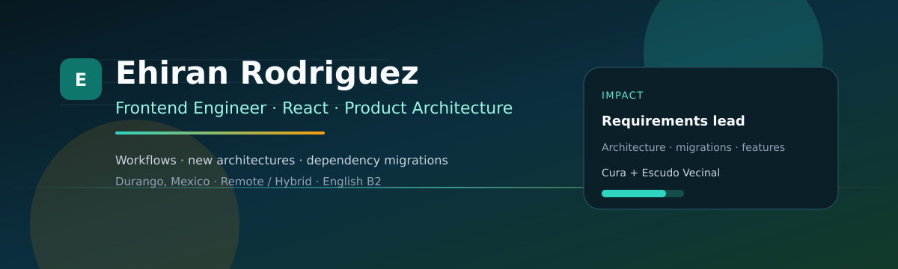

<div align="center">
  <a href="https://github.com/Eknow">
    
  </a>
</div>

<br/>

<div align="center">

[](https://github.com/Eknow)
[](mailto:ehiran.dev@protonmail.com)
[](https://github.com/Eknow)
[](#)


</div>

---

## 👋 Hi, soy Ehiran

**Frontend Engineer** con +3 años construyendo producto en producción (no demos).  
Mi trabajo no es solo “hacer pantallas”: **defino flujos, propongo arquitectura y muevo sistemas viejos hacia estructuras nuevas** sin tumbar el día a día del negocio.

> De liderar **preinscripciones** pasé a impulsar **arquitecturas nuevas**, **migraciones de dependencias** y módulos que aguantan cambio de reglas de negocio.

📍 Durango, México · 🌍 Remoto / híbrido · 🎓 UTD — Desarrollo y Gestión de Software (2025)

---

## 🔥 Qué me diferencia

<table>
<tr>
<td width="50%" valign="top">

### 🧭 Liderazgo de producto
- Lideré el flujo de **preinscripciones** de punta a punta
- Coordiné alcance, reglas y salida a producción
- A partir de ahí tomé más ownership técnico en el dashboard

</td>
<td width="50%" valign="top">

### 🏗️ Ingeniería seria
- Diseño de **arquitecturas nuevas** por features (`api` / `domain` / `workflow` / `ui`)
- **Migraciones de dependencias** y modernización de stacks en producción
- Dominio testeable separado de la UI

</td>
</tr>
</table>

---

## 🚀 Impacto real

### 🏫 Cura · Eficaz Digital
Dashboard SaaS educativo/administrativo en **React**.

- Workflows de **registro, ingreso y transferencia** de alumnos
- Formularios multipaso con validaciones por etapa
- Refactor hacia **nueva arquitectura** (features + dominio)
- Pruebas de reglas críticas (edad, documentos, folios, navegación)

### 📝 Preinscripciones → ownership
No fue solo “un módulo más”:

- Liderazgo funcional/técnico del flujo
- Criterios de aceptación y entrega a producción
- Base para asumir más iniciativas de arquitectura y calidad

### 🛡️ Escudo Vecinal
Sistema de **incidencias ciudadanas** (**web + móvil**).

- Reportes/alertas vecinales con impacto público en Durango
- Experiencia en producto sensible (seguridad / respuesta rápida)

---

## 🛠️ Tech stack

<p align="center">
  
</p>

<details>
<summary><b>Ver stack completo</b></summary>

<br/>

**Lenguajes:** HTML5 · CSS3 · Sass · JavaScript · TypeScript · PHP  

**Frontend:** React · Next.js · Vue · Angular · Redux Toolkit · React Hook Form · TanStack Table  

**UI / Design systems:** Tailwind CSS · MUI · Ant Design · Emotion · Bootstrap  

**Backend & datos:** PHP · MySQL · Node.js  

**Build & deploy:** Vite · Vercel · npm · Git · GitHub · Linux · VS Code  

**Creative:** Figma · Adobe Illustrator · DaVinci Resolve  

</details>

<p align="center">
  
  
  
  
  
  
  
  
  
  
  
  
  
  
</p>

---

## 🧠 Cómo pienso el código

```js
const eknow = {
  role: "Frontend Engineer",
  from: "liderazgo en preinscripciones",
  to: ["arquitecturas nuevas", "migraciones de deps", "ownership de módulos"],
  principles: [
    "dominio fuera de la UI",
    "features desacopladas",
    "migrar sin romper producción",
    "producto > demos"
  ],
  openTo: "Frontend Mid · remoto/híbrido · México"
};
```

---

## 📊 GitHub analytics

<div align="center">
  
  
</div>

<div align="center">
  
</div>

<div align="center">
  
</div>

---

## ✉️ Contacto

<div align="center">

**Si buscas a alguien que lidere módulos, modernice arquitectura y entregue en producción — hablemos.**

📬 [ehiran.dev@protonmail.com](mailto:ehiran.dev@protonmail.com)


</div>
