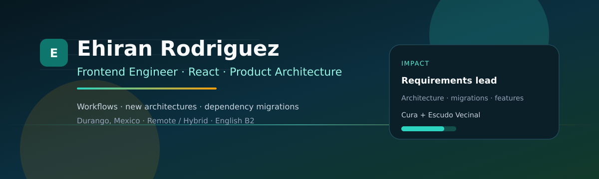

<div align="center">
  
</div>

<br/>

<div align="center">

[](https://github.com/Eknow)
[](mailto:ehiran.dev@protonmail.com)
[](https://github.com/Eknow)
[](#)


</div>

---

## 👋 Hi, I'm Ehiran

**Frontend Engineer** with 3+ years building real production products (not just demos).  
I don't only ship screens — I **define workflows, propose architecture, and move legacy systems toward cleaner structures** without breaking day-to-day operations.

> I've acted as **requirements lead** on key product flows, and also driven **new architectures** and **dependency migrations** in production.

📍 Durango, Mexico · 🌍 Remote / Hybrid · 🎓 Universidad Tecnológica de Durango — Software Development & Management (2025)

---

## 🔥 What sets me apart

<table>
<tr>
<td width="50%" valign="top">

### 🧭 Requirements leadership
- Acted as **requirements lead** on critical product flows
- Translated business needs into clear acceptance criteria
- Coordinated scope and delivery to production

</td>
<td width="50%" valign="top">

### 🏗️ Serious engineering
- Designed **new feature-based architectures** (`api` / `domain` / `workflow` / `ui`)
- Ran **dependency migrations** and stack modernization in production
- Kept business domain testable and separate from UI

</td>
</tr>
</table>

---

## 🚀 Real impact

### 🏫 Cura · Eficaz Digital
Educational / admin SaaS dashboard built with **React**.

- Multi-step **registration, onboarding & transfer** workflows
- Complex forms with stage-based validation
- **Requirements lead** on key flows (including pre-enrollment)
- Refactor toward a **new architecture** (features + domain)
- Unit tests for critical rules (age, documents, folios, navigation)
- Dependency migrations and production modernization

### 🛡️ Escudo Vecinal
Citizen **incident reporting** system (**web + mobile**).

- Neighborhood alerts/reports with public impact in Durango
- Experience with sensitive, emergency-oriented product flows

---

## 🛠️ Tech stack

<p align="center">
  
</p>

<details>
<summary><b>Full stack</b></summary>

<br/>

**Languages:** HTML5 · CSS3 · Sass · JavaScript · TypeScript · PHP  

**Frontend:** React · Next.js · Vue · Angular · Redux Toolkit · React Hook Form · TanStack Table  

**UI / Design systems:** Tailwind CSS · MUI · Ant Design · Emotion · Bootstrap  

**Backend & data:** PHP · MySQL · Node.js  

**Build & deploy:** Vite · Vercel · npm · Git · GitHub · Linux · VS Code  

**Creative:** Figma · Adobe Illustrator · DaVinci Resolve  

</details>

<p align="center">
  
  
  
  
  
  
  
  
  
  
  
  
  
  
</p>

---

## 🧠 How I think about code

```js
const eknow = {
  role: "Frontend Engineer",
  also: ["requirements lead", "new architectures", "dependency migrations"],
  principles: [
    "domain outside the UI",
    "decoupled features",
    "migrate without breaking production",
    "product > demos"
  ],
  openTo: "Mid Frontend · remote/hybrid · Mexico"
};
```

---

## 📊 GitHub analytics

<div align="center">
  
  
</div>

<div align="center">
  
</div>

<div align="center">
  
</div>

---

## ✉️ Contact

<div align="center">

**Looking for someone who can own modules, modernize architecture, and ship to production — let's talk.**

📬 [ehiran.dev@protonmail.com](mailto:ehiran.dev@protonmail.com)


</div>
